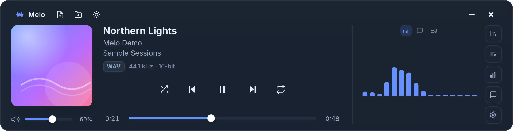
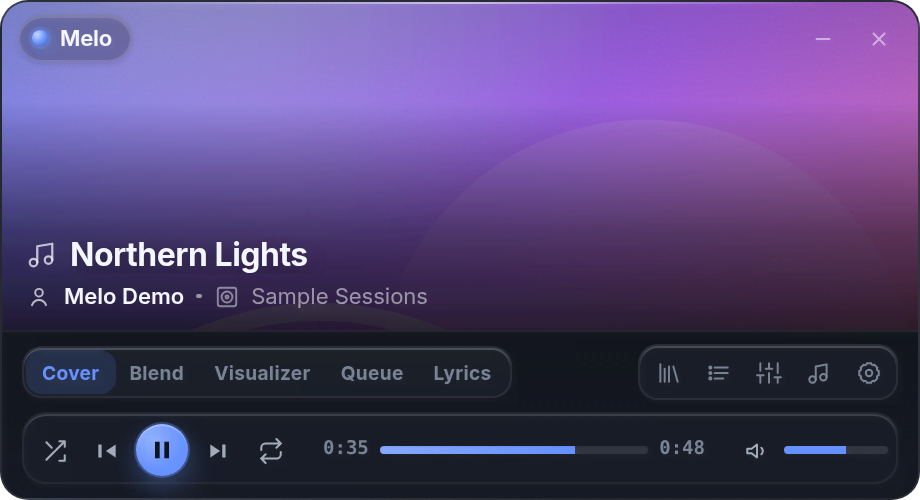
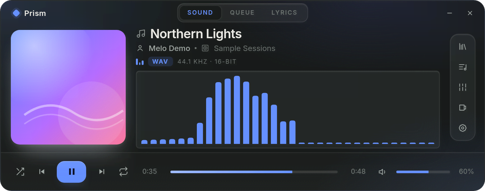

<div align="center">

# 🎵 Melo

**A lightweight, native-feeling music player for Windows**

Built with Tauri 2 · TypeScript · Rust

[](https://github.com/Arvanta/Melo/releases/latest)

[](https://github.com/Arvanta/Melo/releases/latest)

### [⬇️ Download Melo for Windows](https://github.com/Arvanta/Melo/releases/latest)

Installer: `Melo_x64-setup.exe` · MSI package also included on the release page

</div>

---

## 🎨 Skins

Melo's main window is fully re-skinnable. Every skin is a single HTML file you can drop into the skins folder.

<table>
  <tr>
    <td align="center" width="100%">
      <br>
      <b>Default</b>
    </td>
  </tr>
  <tr>
    <td align="center">
      <br>
      <b>Bean</b>
    </td>
  </tr>
  <tr>
    <td align="center">
      <br>
      <b>Prism</b>
    </td>
  </tr>
</table>

---

## ✨ Features

<table>
<tr>
<td width="50%" valign="top">

### 🎧 Playback
- MP3, FLAC, WAV, AAC, OGG, ALAC and Opus
- Shuffle, Repeat (Off / All / One) and seek bar
- Keyboard shortcuts: `Space`, `← →`, `↑ ↓`, `M`, `S`, `R`
- Resumes your last track and position on launch

### 📝 Lyrics
- Synced `.lrc` files and embedded lyrics
- Active line highlight, auto-scroll and click-to-seek
- Current lyric line can appear in skins that support it
- Melo can now search for lyrics online when a track has none, so you don't have to add .lrc files by hand.

### 🎛️ Equalizer
- 10 bands from 31 Hz to 16 kHz
- 12 presets, plus Reset

</td>
<td width="50%" valign="top">

### 📚 Library
- Albums, Artists, Album Artists and Genres
- Album Sheets, Tiles, Details and Compact views
- Automatic playlists: **Most Played**, **Recently Added**, **Recently Played**
- Artist sidebar and search across artists, albums and tracks

### 🗂️ Playlists
- Multiple playlists with drag-and-drop reordering
- Search, sorting and M3U / M3U8 import and export
- Find-in-Queue for long play queues

### 🪟 Windows Integration
- Library, Playlist, Equalizer, Lyrics and Settings open as separate windows
- System tray menu with playback controls

</td>
</tr>
</table>

---

## 📥 Install

1. Go to the **[latest release](https://github.com/Arvanta/Melo/releases/latest)**.
2. Download `Melo_x64-setup.exe` (or the `.msi`).
3. Run the installer. Melo is installed to `C:\Program Files\Melo`.

Updates are installed the same way: download the newer installer and run it.

---

## 🧩 Customize

- **Skins:** open **Settings → Appearance & Skin → Open Skins Folder**, drop in any `.html` skin, then press Refresh.
- **Skin authoring:** [skins/README.md](skins/README.md) covers layout, styling and the `data-melo` hooks.

---

<details>
<summary><b>🛠️ For developers</b></summary>

### Build for Windows (GitHub Actions)

The `Build Melo` workflow runs on every push to `main`, or manually from **Actions → Run workflow**. It produces a **draft release** with the installers attached. Publish it when you are ready.

### Run in a browser (dev server)

```bash
npm install
npm run dev      # http://localhost:1420
```

### Publishing a new version

```bash
node tools/version.mjs 1.2.0     # bumps every version-declaring file at once
node tools/version.mjs --check   # confirm they all agree
git commit -am "Melo 1.2.0"
git push
```

The workflow stops before compiling if the versions disagree or if the tag already exists, so a version that was ever built is never replaced.

### Tech notes
- **Rust:** `lofty` for metadata, `walkdir` with background workers for scanning, SQLite for the Library, disk-cached artwork, and `tauri-plugin-single-instance`.
- **Frontend audio:** `HTMLAudioElement` with one shared `AudioContext` (EQ filters → gain → analyser → output).
- **Desktop metadata:** `music-metadata-browser` is excluded from desktop bundles to keep the build small.

</details>

---

<div align="center">

**Support development:** [arvanta.github.io](https://arvanta.github.io)

GPL-3.0 · © Melo Team

</div>
